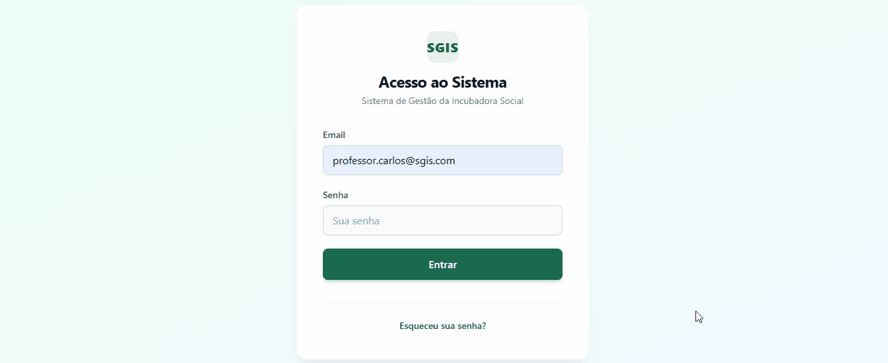

# Projeto: SGIS — Sistema de Gestão da Incubadora Social



## Acesso

link:

## Desenvolvedores

Nomes: Carlos Eduardo Velozo, Miguel Brondani
Curso: Ciência da Computação

Repositório do projeto: https://github.com/IS-UFSM/SGIS

## Proposta

Implementação de um Minimum Viable Product do sistema de gestão idealizado pela Incubadora Social. Criação de 3 tipos de usuários:

- **Empreendimento**: visualizar e marcar como feitas as atividades propostas pelo professor; visualizar acompanhamentos definidos pela incubadora.
- **Professor/Projeto**: visualizar os empreendimentos sob sua supervisão e suas situações; gerenciar atividades para cada empreendimento.
- **Incubadora Social**: gerenciar e monitorar novos usuários; visualizar estatísticas gerais do sistema.

## Desenvolvimento

### Processo

<!-- ESCREVA ESTA SEÇÃO VOCÊS MESMOS, EM PRIMEIRA PESSOA E SEM IA.
     Abaixo, um roteiro de perguntas para guiar a escrita (apague este comentário e escreva a prosa):

     - Como a dupla se organizou? (ex.: dividimos por app; um cuidou de models/migrations,
       outro de views/templates; ou programamos em par juntinho em reuniões semanais)
     - Como foi a primeira reunião com a Incubadora Social e o que saiu dela?
     - O que vocês já sabiam de Django/HTML antes? O que tiveram que aprender?
     - Dificuldade específica que teve: ex. entender custom user model (AUTH_USER_MODEL) e
       por que substituir o username pelo email; migração com dado inicial (usuário IS padrão);
       por que validação de papel no formulário E no servidor; signals do Django para inscrever
       automaticamente na pré-incubação; constraints no banco (UniqueConstraint condicional).
     - Como resolveram: docs do Django, teste repro, conversa com colega/professor, etc.
     - O que mudou no plano original (o MVP pedia convite por email; implementamos cadastro direto). -->

Sobre a organização da dupla: o Miguel já conhecia melhor o projeto, porque tinha
participado do levantamento das regras com a Incubadora Social, então ficou com o
papel de organizar o trabalho. Dividia as regras de negócio em tasks pequenas e
repassava para equipe. A equipe executava essas tasks e revisava os documentos
de reguas de negócio para entender o que o sistema precisava antes de codar.

Dificuldades por Carlos:
A maior dificuldade que eu tive foi justamente essa: me integrar ao projeto e
entender as regras de negócio. Como várias decisões já estavam tomadas quando eu
entrei, precisei entender o "porquê" de cada uma antes de mexer.

### Trechos de código

1. **`usuarios/decorators.py` — o decorator `papel_requerido`**

   Esse foi o primeiro decorator que a gente escreveu do zero e levou um tempinho até ficar claro como uma função pode retornar outra função "embrulhando" a view. Ele primeiro aplica o `login_required` e só depois compara o papel, então a ordem dos decoradores importa de verdade, se trocasse daria erro tentando acessar `request.user.papel` de usuário anônimo.

   ```python
   def papel_requerido(*papeis):
       def decorator(view_func):
           @wraps(view_func)
           @login_required
           def _wrapped(request, *args, **kwargs):
               if request.user.papel not in papeis:
                   raise PermissionDenied
               return view_func(request, *args, **kwargs)
       return decorator
   ```

2. **`trilhas/signals.py` — a inscrição automática na pré-incubação**

   A Incubadora pediu que todo empreendimento novo já entrasse na trilha de pré-incubação sem ninguém precisar fazer nada. A primeira ideia foi colocar isso dentro da view que cria o empreendimento, mas aí valeria só praquela view. Se o registro viesse do admin ou de outro lugar, não funcionaria. Foi quando apareceu o signal `post_save`. Demorou pra gente entender que ele dispara em **todo** `save()`, por isso tem o `if not created` ali em cima: sem isso, toda vez que o empreendimento fosse editado ele tentava se inscrever de novo.

   ```python
   @receiver(post_save, sender=Empreendimento)
   def inscrever_na_pre_incubacao(sender, instance, created, raw=False, **kwargs):
       if not created or raw:
           return
       trilha = Trilha.objects.filter(pre_incubacao=True).first()
       if trilha is None:
           return
       Inscricao.objects.get_or_create(
           empreendimento=instance,
           trilha=trilha,
           defaults={'status': Inscricao.Status.ATIVA},
       )
   ```

3. **`usuarios/views.py` — a troca de senha sem deslogar o usuário**

   A aba "Minha conta" (`/conta/senha/`) deixa qualquer usuário logado trocar a própria senha, sem precisar passar pela IS. O detalhe que mais deu trabalho foi manter a sessão viva depois da troca: o Django guarda no cookie de sessão um hash da senha do usuário, então assim que a senha muda esse hash deixa de bater e a pessoa seria jogada para a tela de login no meio da própria troca. A solução é o `update_session_auth_hash`, que refaz esse hash dentro da sessão atual. O resto é o `set_password` (guarda com hash, nunca em texto puro) e a validação no formulário: a senha atual precisa estar certa, a confirmação tem que bater com a nova e a nova senha passa pelos validadores do `AUTH_PASSWORD_VALIDATORS` (tamanho mínimo, senha muito comum, só números e parecida com o e-mail).

   ```python
   @login_required
   def trocar_senha_view(request):
       """Usuário logado troca a própria senha (qualquer papel)."""
       form = TrocarSenhaForm(request.POST or None, user=request.user)

       if request.method == 'POST' and form.is_valid():
           request.user.set_password(form.cleaned_data['nova_senha'])
           request.user.save(update_fields=['password'])
           # O hash do usuário mudou: sem isto a sessão atual seria encerrada.
           update_session_auth_hash(request, request.user)
           messages.success(request, 'Senha alterada com sucesso.')
           return redirect('trocar_senha')

       return render(request, 'usuarios/trocar_senha.html', {'form': form})
   ```

## Tecnologias

### Linguagens e afins

- **Python 3.13** — linguagem do backend
- **Django 6.1** — framework web full-stack (ORM, templates, migrations, admin, sessões, testes)
- **HTML** com **Django Template Language** — páginas server-side
- **Tailwind CSS** (via CDN) — estilização utilitária, sem build
- **SQLite** — banco de dados (padrão do Django, trocável por Postgres/MySQL)
- **Git/GitHub** — versionamento e revisão por pull requests

### Autenticação e autorização

- **Autenticação por sessão** (cookie de sessão gerenciado pelo `django.contrib.sessions`) — não usamos tokens/JWT, pois o app é 100% server-rendered.
- **Modelo de usuário customizado** (`AUTH_USER_MODEL = 'usuarios.Usuario'`): login pelo **e-mail**, não por username, com senha armazenada com hash (PBKDF2) via `set_password`. A migration `0002` cria um usuário IS padrão para o primeiro acesso.
- **Cadastro pela interface**: a IS cria contas de professor/empreendimento em `/usuarios/novo/`, definindo a senha inicial.
- **Troca de senha pelo próprio usuário**: aba "Minha conta" em `/conta/senha/`, disponível para todos os papéis logados. Exige a senha atual, confirma a nova e passa a senha pelos validadores do Django; a sessão continua ativa depois da troca (`update_session_auth_hash`).
- **Autorização por papel** (`admin`, `is`, `professor`, `empreendimento`): decorator `papel_requerido` em toda view; usuário de outro papel recebe 403 e anônimo é redirecionado ao login (inclusive em URLs inexistentes).
- **Defesa em profundidade**: o formulário de cadastro restringe os papéis criáveis no servidor (a IS não cria IS/admin nem forjando o POST), e o CSRF token é exigido em todos os POSTs.

### Ambiente de desenvolvimento

- **Visual Studio Code**
- **Python 3.13** com ambiente virtual (`.venv`)
- **Terminal integrada do VS Code** para comandos `manage.py`
- **Django admin** (`/admin/`) para inspeção/ajuste rápido de dados durante o desenvolvimento
- **Testes automatizados** do Django (`python manage.py test`) — 50 testes cobrindo permissões, trilhas, inscrições e troca de senha
- **GitHub** com trabalho em branches + pull requests
- **Auxílio de IA** (OpenCode) para dúvidas pontuais de sintaxe e revisão — sempre validando o resultado com os testes e a documentação oficial

## Referências e créditos
- Repositório do projeto (código-fonte completo): https://github.com/IS-UFSM/SGIS
- Documentação oficial do Django: https://docs.djangoproject.com/ (custom user model, signals, constraints, testing)
- Guia "Extending the User Model" do Django — https://docs.djangoproject.com/en/stable/topics/auth/customizing/
- Tailwind CSS — https://tailwindcss.com/docs
- Documentação da disciplina ELC1090 — http://github.com/andreainfufsm/elc1090-2026b
- [Reunião com a Incubadora Social (08/10)](https://docs.google.com/document/d/1hjom8iviEU5f6He7RsyRFO3UuHWmsLh_FywNCSXnfks/edit)
- Especificações do projeto em `specs/SGIS_SPEC_MVP.md` e `specs/SGIS_SPEC_COMPLETA.md` (elaboradas com a Incubadora Social)
- Colégas da turma: dúvidas resolvidas em conversas sobre decorators e signals

---
Projeto entregue para a disciplina de [Desenvolvimento de Software para a Web](http://github.com/andreainfufsm/elc1090-2026b) em 2026b