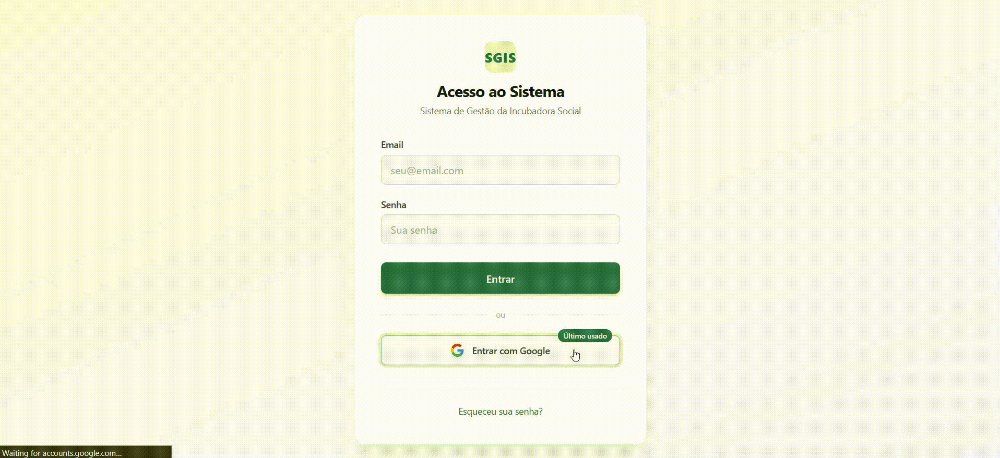

# SGIS — Login federado com Google



## Acesso

[https://sgis-i7an.onrender.com/](https://sgis-i7an.onrender.com/)


## Desenvolvedor(a) / Desenvolvedor(es/as)

- Miguel Brondani

## Proposta

**Continuação** do SGIS (Sistema de Gestão da Incubadora Social da UFSM), desenvolvido no projeto anterior. Este projeto acrescenta o **login federado com Google** (OAuth 2.0 / OpenID Connect).

O que foi feito:

- **Entrar com Google** na tela de login, ao lado do e-mail e senha. Se a conta do SGIS já existe com o mesmo e-mail, o Google é ligado a ela automaticamente.
- **Cadastro com aprovação:** um e-mail do Google sem conta no SGIS vira um cadastro de empreendedor **desativado**. A IS vê esses cadastros em *Usuários* como "Aguardando aprovação" e, ao aprovar, informa o empreendimento da pessoa: a conta é liberada e o empreendimento é criado junto, já inscrito na pré-incubação.
- **Só empreendedores** entram pelo Google. Contas da IS, de professores e de admin continuam entrando só com senha.
- **"Último usado":** a tela de login destaca o método usado no último acesso daquele navegador, guardado num cookie que não identifica a pessoa.
- **Rotas do allauth fechadas:** páginas da biblioteca que contornariam regras do SGIS (redefinir senha por e-mail, trocar o e-mail da conta, desligar o Google da conta) respondem 404.

## Desenvolvimento

### Processo

A primeira parte foi entender como o login federado ia se encaixar no SGIS. Comecei configurando o django-allauth com o provedor do Google, e qualquer pessoa que entrasse com uma conta Google virava automaticamente um empreendedor. Funcionou, mas essa escolha ia contra a regra de que quem decide quem entra no sistema é a IS.

Durante o desenvolvimento, fazendo login no GitHub, notei que ele marca com "Último usado" a forma de login da vez anterior. Quis entender como isso funcionava e reproduzi no SGIS. Usando Cookies, o último método de login fica salvo no computador. 

Fiz alguns testes de uso e identifiquei alguns erros: acesso indevido à algumas páginas, substituição de senhas de contas já criadas quando o login era feito pelo google.  
Fechei as rotas desnecessárias e restringi o acesso via google para apenas empreendedores já cadastrados. Depois, percebi que poderia usar o sistema já existente de contas "ativas" e "desativadas": uma conta criada pelo google é automaticamente uma "desativada", apenas quando a IS "reativa" o usuário consegue fazer login. Ainda assim, o empreendedor não teria um empreendimento ligado a ele, de forma que o sistema se tornaria inútil para ele. Fiz com que houvesse uma pseudo categoria "aguardando aprovacao", resultado de ser uma conta criada com google + "desativada" + sem empreendimento registrado. Agora, quando a IS vai ativar um cadastro 'aguardando aprovação', precisa preencher o formulário do empreendimento daquele empreendedor.

Usei o Claude durante todo o desenvolvimento, principalmente como revisor. Ele apontava os problemas, explicava o funcionamento e apresentava alternativas, e eu decidia o caminho.


### Trechos de código

1. **`usuarios/federado.py`**

   O allauth tem uma proteção: quando liga um login do Google a uma conta que já existe pelo e-mail, e esse e-mail **não está marcado como verificado**, ele apaga a senha da conta. A ideia é impedir que alguém crie uma conta com o e-mail de outra pessoa, defina uma senha e espere a vítima entrar pelo Google. Só que no SGIS nenhum e-mail é "verificado": quem cria as contas é a IS. Resultado: no primeiro login pelo Google, a pessoa perdia a senha. Como o e-mail foi cadastrado pela IS (e o Google também o confirma), marcamos o endereço como verificado antes de o allauth decidir:

   ```python
   def pre_social_login(self, request, sociallogin):
       usuario = sociallogin.user
       if usuario.pk is None:
           return
       if usuario.papel != Usuario.Papel.EMPREENDEDOR:
           self._recusar(request, 'O login com Google é só para empreendedores. Entre com e-mail e senha.')

       if not usuario.is_active:
           self._recusar(request, "Aguardando liberação pela Incubadora Social.")

       EmailAddress.objects.update_or_create(
           user=usuario, email=usuario.email, defaults={'verified': True, 'primary': True},
       )
   ```

2. **`usuarios/federado.py`**

   Para o cadastro pelo Google depender da IS, a conta é criada normalmente pelo allauth e, logo em seguida, desativada. O detalhe é o `ImmediateHttpResponse`: é a forma do allauth de interromper o fluxo no meio e devolver outra resposta. Sem ele, o allauth tentaria fazer o login logo depois de criar a conta.

   ```python
   def save_user(self, request, sociallogin, form=None):
       usuario = super().save_user(request, sociallogin, form)
       usuario.is_active = False
       usuario.save(update_fields=['is_active'])
       messages.success(request, 'Cadastro recebido. Aguarde a Incubadora Social liberar o seu acesso.')
       raise ImmediateHttpResponse(redirect('login'))
   ```

3. **`usuarios/regras.py`**

   Não criamos um campo `status` no banco. "Aguardando aprovação" é calculado: empreendedor, desativado, ligado ao Google e ainda sem empreendimento. Assim que a IS aprova, o empreendimento passa a existir e a conta sai da fila sozinha. Uma conta que a IS desativou de propósito não tem Google ligado, então continua com o botão "Reativar". A aprovação usa `transaction.atomic`: ou a conta é liberada **e** o empreendimento é criado, ou nada acontece.

   ```python
   def aguardando_aprovacao():
       return Usuario.objects.filter(
           papel=Usuario.Papel.EMPREENDEDOR,
           is_active=False,
           socialaccount__isnull=False,
           empreendimentos__isnull=True,
       ).distinct()


   @transaction.atomic
   def aprovar_cadastro(conta, usuario, dados_empreendimento):
       exigir_gestao(usuario, conta)
       if not aguardando_aprovacao().filter(pk=conta.pk).exists():
           raise RegraViolada("Conta não aguarda aprovação.")
       conta.is_active = True
       conta.save(update_fields=['is_active'])
       return vincular_empreendimento(conta, dados_empreendimento)
   ```

4. **`usuarios/sinais.py` e `usuarios/middleware.py` — o selo "Último usado"**

   O signal `user_logged_in` sabe **como** a pessoa entrou (pelo backend de autenticação), mas não tem acesso à resposta HTTP, onde o cookie é gravado. Por isso o signal só anota o método no `request`, e um middleware grava o cookie na saída. O cookie guarda só `senha` ou `google`, nunca o e-mail, e não é apagado no logout: é isso que faz o selo aparecer na próxima visita.

   ```python
   @receiver(user_logged_in)
   def registrar_metodo_de_login(sender, request, user, **kwargs):
       metodo = METODO_POR_BACKEND.get(getattr(user, 'backend', ''))
       if metodo:
           request.metodo_login = metodo
   ```

   ```python
   def __call__(self, request):
       response = self.get_response(request)
       metodo = getattr(request, 'metodo_login', None)
       if metodo:
           response.set_cookie(COOKIE_METODO_LOGIN, metodo, max_age=60 * 60 * 24 * 31,
                               httponly=True, samesite='Lax', secure=not settings.DEBUG)
       return response
   ```

## Tecnologias

### Linguagens e afins

- **Python 3.12+** e **Django 6.1**
- **django-allauth 65**: Login federado com Google de provedor, com adapters próprios em `usuarios/federado.py`
- **Google Identity (OAuth 2.0 / OpenID Connect)**: credenciais criadas no Google Cloud Console
- **HTML** com **Django Template Language** e **Tailwind CSS** (via CDN) — páginas renderizadas no servidor
- **SQLite** em desenvolvimento e **PostgreSQL** em produção (`dj-database-url`)
- **Render**
- **GitHub Actions** — a cada push roda a suíte de testes e confere migrações pendentes (`.github/workflows/testes.yml`)

### Ambiente de desenvolvimento

- **Visual Studio Code**, com ambiente virtual Python (`venv`)
- **Claude Code** (app desktop) — usado para revisar o código do login federado, encontrar falhas (rotas abertas do allauth, a senha apagada no primeiro login pelo Google, erro 500 sem credenciais), propor correções e escrever os testes que simulam o retorno do Google; tudo conferido com a suíte de testes e no navegador
- **Testes automatizados** do Django (`python manage.py test`), incluindo `usuarios/test_federado.py` e `usuarios/test_aprovacao.py`
- **DevTools do navegador** — para acompanhar o cookie `sgis_ultimo_login` (abas *Application* e *Network*)
- **Git e GitHub**, com GitHub Actions

## Referências e créditos

- Repositório original do SGIS: https://github.com/IS-UFSM/SGIS
- Documentação do django-allauth: https://docs.allauth.org/ (provedor Google, adapters, *email authentication*)
- Google Identity — OAuth 2.0 para aplicativos web: https://developers.google.com/identity/protocols/oauth2/web-server
- Diretrizes de marca do botão "Sign in with Google": https://developers.google.com/identity/branding-guidelines
- Documentação do Django: https://docs.djangoproject.com/ (signals, middleware, mensagens, testes)
- Render — deploy de Django e blueprints: https://render.com/docs/deploy-django
- MDN — cookies HTTP (`HttpOnly`, `SameSite`, `Secure`): https://developer.mozilla.org/pt-BR/docs/Web/HTTP/Cookies

---
Projeto entregue para a disciplina de [Desenvolvimento de Software para a Web](http://github.com/andreainfufsm/elc1090-2026b) em 2026b
